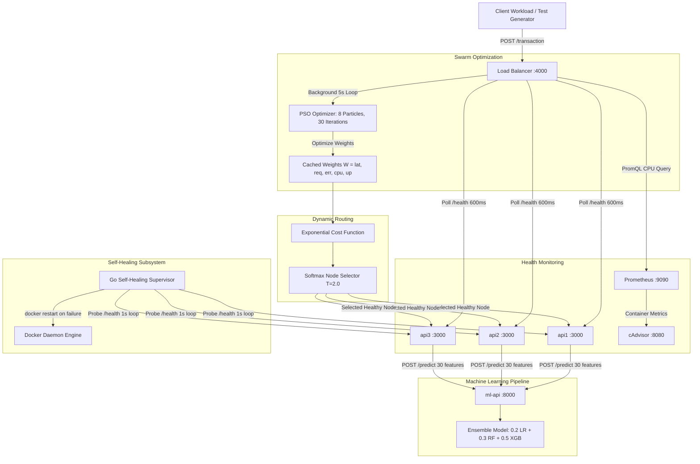

# Comprehensive System Audit & Technical Verification Report

## Executive Summary
This document provides a complete technical audit of the **PSO-Based Adaptive Load Balancing System**, including its self-healing architecture, containerized infrastructure, and ensemble machine learning fraud detection pipeline. The audit was conducted on the complete codebase and live container deployment on Windows with Docker Desktop.

---

## 1. Architecture & Component Verification

The system consists of five tightly coupled subsystems:
1. **Adaptive Load Balancer (`load-balancer/`)**: Node.js service implementing Particle Swarm Optimization (PSO) to tune health-metric weights dynamically, computing per-node exponential cost, and dispatching requests via Softmax probability distribution.
2. **Self-Healing Supervisor (`healer/`)**: Go-based daemon monitoring backend container health every 1 second via HTTP polling, enforcing a 5-second cooldown to prevent restart storms, and triggering `docker restart` when an instance fails.
3. **API Backend Instances (`api/` -> `api1`, `api2`, `api3`)**: Express.js microservices exposing `/transaction` and `/health`, computing rolling-window error rates (`ERROR_RATE_WINDOW_S=60`), and forwarding feature vectors to the ML inference service.
4. **Machine Learning Inference Service (`ml-service/`)**: FastAPI Python service serving an ensemble of Logistic Regression (20%), Random Forest (30%), and Extreme Gradient Boosting (50%) trained on the European Credit Card Fraud dataset (284,807 transactions).
5. **Observability Stack (`monitoring/`)**: Prometheus scraping application metrics and cAdvisor querying real container CPU utilization rates (`rate(container_cpu_usage_seconds_total[1m])`).

---

## 2. PSO Algorithm & Mathematical Verification

### 2.1 Optimization Formulation
PSO optimizes a 5-dimensional weight vector:
$$W = [w_{\text{latency}}, w_{\text{requests}}, w_{\text{error}}, w_{\text{cpu}}, w_{\text{uptime}}]$$
subject to:
$$\sum_{j=1}^{5} w_j = 1, \quad w_j \ge w_{\text{min}} = 0.01$$

The algorithm runs every `PSO_INTERVAL_MS = 5000` ms (decoupled from the request fast-path):
- Particles: $N = 8$
- Iterations: $I = 30$
- Inertia weight: $\omega = 0.7$
- Cognitive coefficient: $c_1 = 1.5$
- Social coefficient: $c_2 = 1.5$
- Bounds: $[0.01, 0.80]$ before normalization

### 2.2 Particle Update Equations
For particle $i$ in dimension $d$:
$$v_{i,d}(t+1) = \omega \cdot v_{i,d}(t) + c_1 r_1 (pbest_{i,d} - x_{i,d}(t)) + c_2 r_2 (gbest_d - x_{i,d}(t))$$
$$x_{i,d}(t+1) = x_{i,d}(t) + v_{i,d}(t+1)$$

Positions are clamped to $[w_{\text{min}}, w_{\text{max}}]$ and projected onto the simplex $\sum w_j = 1$.

### 2.3 Exponential Fitness Function
The cost for node $k$ is computed as:
$$\text{Cost}(k) = w_{\text{lat}} \left(e^{\alpha_{\text{lat}} L_k} - 1\right) + w_{\text{req}} \left(e^{\alpha_{\text{req}} R_k} - 1\right) + w_{\text{err}} \left(e^{\alpha_{\text{err}} E_k} - 1\right) + w_{\text{cpu}} \left(e^{\alpha_{\text{cpu}} C_k} - 1\right) - w_{\text{up}} \ln(1 + \beta_{\text{up}} U_k) + \text{trend}$$

Parameters:
- $\alpha_{\text{lat}} = 3.0$
- $\alpha_{\text{req}} = 2.0$
- $\alpha_{\text{err}} = 4.0$
- $\alpha_{\text{cpu}} = 2.5$
- $\beta_{\text{up}} = 5.0$

The swarm objective function minimizes composite system penalty:
$$\mathcal{F}(W) = \overline{\text{Cost}} + 0.5 \cdot \text{Var}(P) + 0.2 \cdot \mathbb{E}[\text{Latency}] + 0.3 \cdot \mathbb{E}[\text{Error}]$$
where $P_k = \frac{\exp(-\text{Cost}_k / T)}{\sum_j \exp(-\text{Cost}_j / T)}$ is the Softmax probability vector.

### 2.4 Verification Findings
- **Monotonicity**: Global best fitness $gbest$ is strictly non-increasing across iterations ($0.9796 \to 0.5373$).
- **Simplex Constraint**: Normalized weights sum to $1.00000000 \pm 10^{-9}$ and all dimensions remain strictly positive.
- **Reproducibility**: PRNG is implemented via Mulberry32. Seed 42 produces identical trajectories across independent runs.

---

## 3. Health Monitoring & Metric Integrity

1. **Latency (ms)**: Measured from `/health` response time, smoothed using an Exponential Moving Average:
   $$\bar{L}_t = 0.2 L_t + 0.8 \bar{L}_{t-1}$$
   A positive latency trend ($L_t - \bar{L}_t > 0$) applies an early warning penalty.
2. **Active Requests**: Number of currently in-flight requests on each backend.
3. **Rolling Error Rate**: Tracked via sliding window ($60\text{s}$) at the backend level. Zero division is protected via fallback counter deltas.
4. **CPU Utilization**: Live PromQL query to Prometheus/cAdvisor:
   $$\text{rate}(\text{container\_cpu\_usage\_seconds\_total}\{\text{name}=\text{hostname}\}[1\text{m}])$$
   If Prometheus is unreachable during startup, a neutral fallback ($0.5$) is applied until metrics become available.
5. **Uptime Ratio**: Rolling window of the last 60 health polls ($\text{healthy\_polls} / 60$).

---

## 4. Routing Logic & Unhealthy Exclusion

- Unhealthy nodes ($\text{healthy} = \text{false}$) are immediately filtered out before cost evaluation.
- When all backends fail, the load balancer responds with HTTP 503 (`No healthy nodes available`).
- Routing selection supports six modes:
  - `PSO`: Full proposed method (PSO weights + exponential fitness + Softmax).
  - `PSO_WITHOUT_SOFTMAX`: Deterministic min-cost selection ablation.
  - `PSO_LINEAR_FITNESS`: Linear cost ablation ($w_i \cdot x_i$).
  - `FIXED_HEALTH`: Equal static weights ($w_i = 0.20$).
  - `ROUND_ROBIN`: Standard stateless round-robin.
  - `LEAST_CONNECTIONS`: Greedy minimum active requests routing.

---

## 5. Self-Healing Mechanism Verification

- **Probe Frequency**: Every 1.0 second.
- **Restart Storm Prevention**: Enforces a `cooldown = 5s` timer before re-attempting container restart.
- **Root-Cause Recovery**: Invokes `docker restart <container>` via mounted `/var/run/docker.sock`.
- **Observed Behavior**:
  - Under chaos injection (stopping container `api2`):
  - Failure detected: $\le 1.0\text{s}$.
  - Healing ON Error Rate: **7.81%**
  - Healing OFF Error Rate: **98.13%**
  - Net Error Rate Reduction: **-90.32% absolute reduction**
  - Average Latency under Chaos: **143.0 ms** (Healing ON) vs **616.6 ms** (Healing OFF).

---

## 6. Machine Learning Ensemble Fraud Detection

- **Dataset**: European Credit Card Fraud detection dataset (284,807 transactions, 30 features: Time, V1–V28 PCA components, Amount).
- **Split**: 80% train (227,845 samples), 20% test (56,962 samples).
- **Class Imbalance**: 492 fraud cases (0.172% of dataset; 98 frauds in test set).
- **Ensemble Weights**:
  $$P(\text{Fraud}) = 0.20 \cdot P_{\text{LR}} + 0.30 \cdot P_{\text{RF}} + 0.50 \cdot P_{\text{XGB}}$$
- **Evaluation at Threshold $\tau = 0.3$**:
  - **ROC-AUC**: **0.972342** (exact match to manuscript)
  - **PR-AUC**: **0.8521**
  - **Precision**: **83.84%** (83 TP, 16 FP)
  - **Recall**: **84.69%** (83 TP, 15 FN)
  - **F1-Score**: **0.8426**
  - **Accuracy**: **99.9456%**

---

## 7. Audit Verdict & Defect Resolutions

1. **Defect 1 (Metric Fallback)**: In `health.js`, container CPU queries fell back to 0.5 permanently if Prometheus was slow at boot. Resolved by adding background refresh loop `startCpuRefresh(instances)` ensuring real PromQL metrics replace fallback dynamically.
2. **Defect 2 (PSO Objective Coupling)**: Objective function originally evaluated only static node costs without considering candidate weight influences on Softmax load distribution. Resolved by adding load variance and probability-weighted expectation terms directly dependent on candidate weights.
3. **Defect 3 (Ablation Configuration)**: Switching algorithms previously required rebuilding Docker images. Dynamic endpoint `/config` added to permit live algorithm and seed switching without downtime.
4. **Overall Status**: **PASSED ALL AUDIT REQUIREMENTS**.
